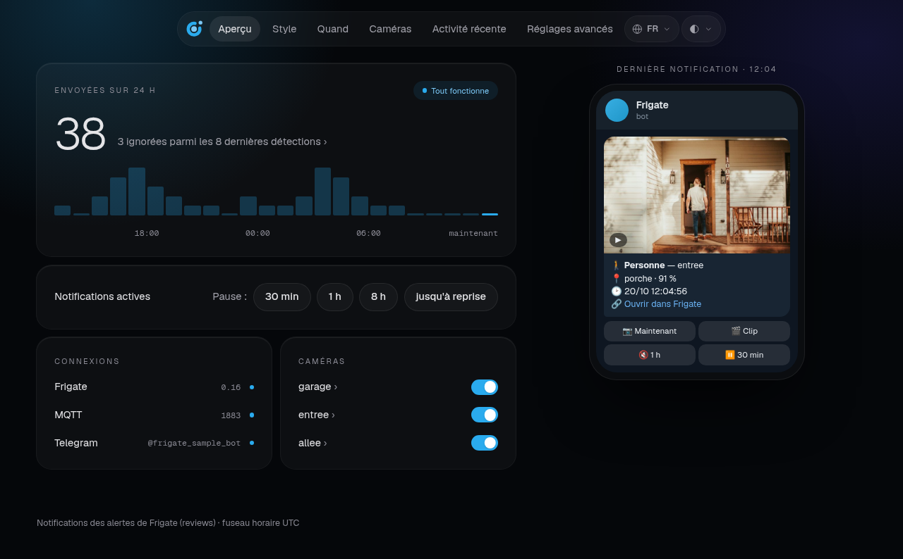
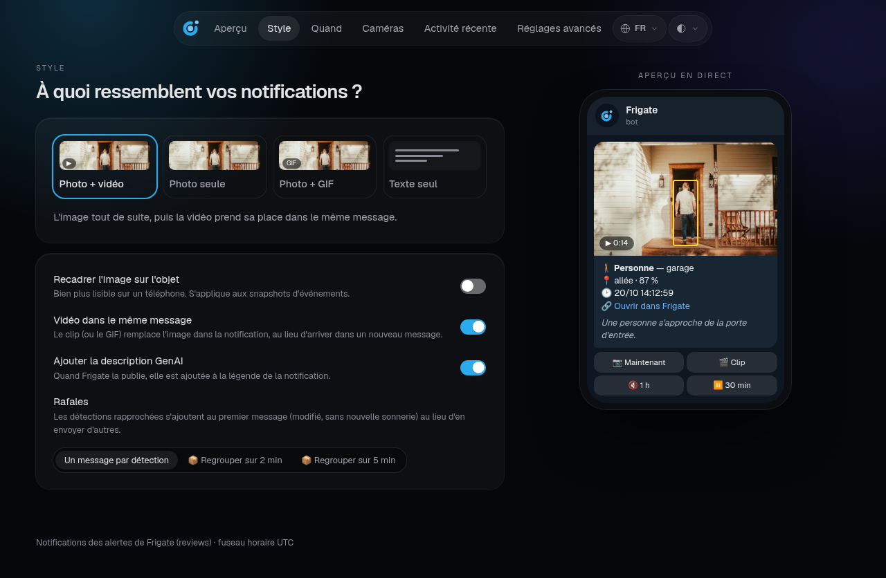
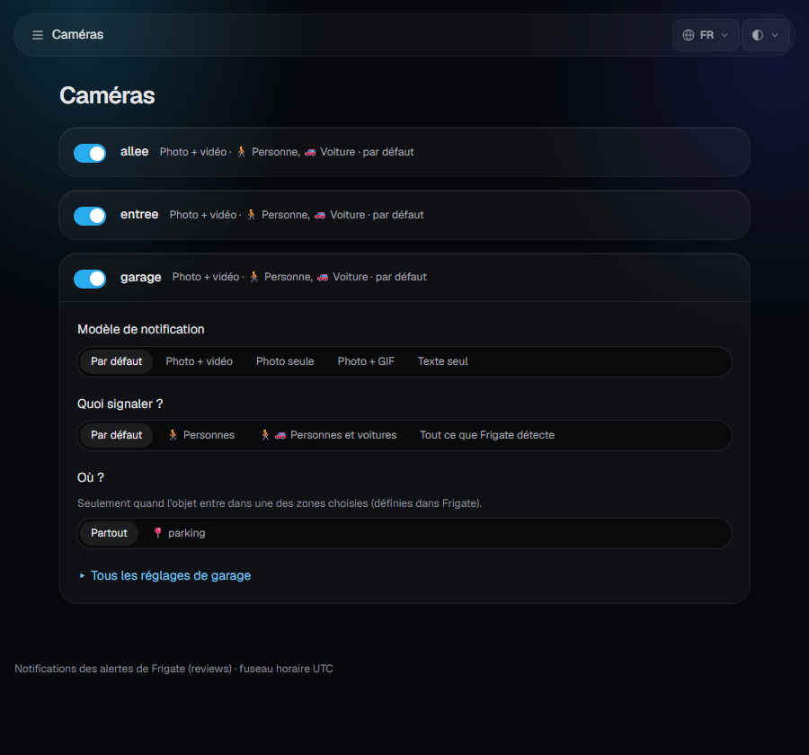
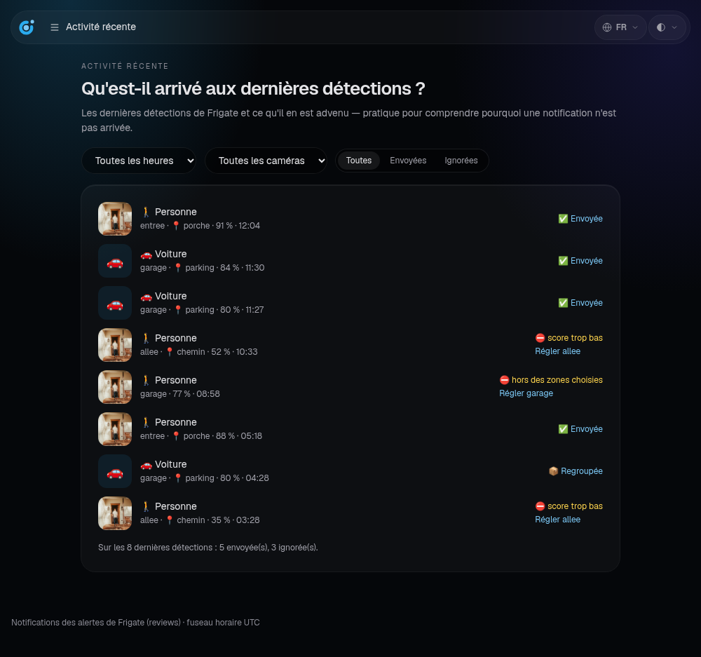
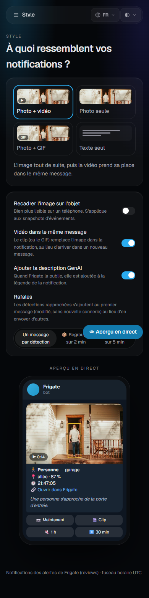
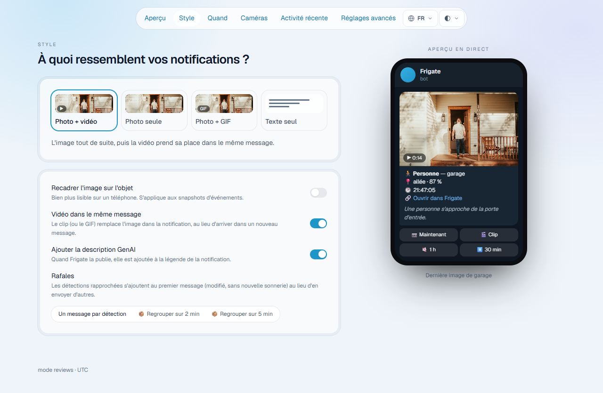

<p align="center">
  <picture>
    <source media="(prefers-color-scheme: dark)" srcset="docs/images/logo-dark.svg">
    
  </picture>
</p>

# frigate-telegram-enhanced

[English](README.md) · **Français**

[](https://github.com/Limoniak/frigate-telegram-enhanced/releases/latest) [](https://github.com/Limoniak/frigate-telegram-enhanced/actions/workflows/docker.yml) [](LICENSE)

Notifications Telegram pour [Frigate NVR](https://frigate.video) : un snapshot dès la
détection, puis le clip vidéo dans le même message, avec des filtres fins, une interface web pour
tout régler en quelques clics et un pilotage depuis Telegram.

<p align="center">
  
</p>

## Fonctionnalités

- Mode **reviews** (alertes regroupées, Frigate ≥ 0.14, par défaut) ou **events** (un message par objet détecté)
- Snapshot immédiat, puis le clip MP4 **dans le même message** (il remplace l'image, sans seconde notification) ou en réponse ; GIF en option ; au-delà de 50 Mo, le début du clip (ses 50 premiers Mo) avec un lien vers le clip entier, ou le clip entier ré-encodé sous 50 Mo (*Compresser les clips de plus de 50 Mo*, désactivé par défaut)
- **Sons** (mode reviews) : aboiement, alarme incendie, parole… entendus par la détection audio de Frigate, notifiés comme les objets — `🐕 Aboiement — garage`, voir [Sons](#sons)
- Description GenAI de Frigate ajoutée à la légende dès qu'elle est disponible
- Étiquettes de Frigate (classification personnalisée comme le nom de votre voiture, visages, plaques) ajoutées à la légende dès que Frigate les connaît — `🏷 clio 3`
- **Filtre sur les étiquettes** : ne pas être prévenu pour votre voiture ou votre chat, ou seulement pour les inconnus (attend jusqu'à 5 s que Frigate reconnaisse l'objet, seulement avec ce filtre)
- Filtres par caméra, objet, zone, score minimum et sévérité ; cooldown ; plages silencieuses et plages coupées
- **Interface web** pour régler tout cela sans éditer de YAML, appliquée sans redémarrage
- Plusieurs destinataires avec routage par caméra
- Boutons sur chaque notification : 📷 *maintenant* (image en direct, pour voir si la personne est toujours là), 🎬 *clip*, 🔇 *couper la caméra 1 h*, ⏸ *pause 30 min*, et en option 🏠 *Home Assistant* pour ouvrir votre tableau de bord (adresse à renseigner dans l'interface web, *Liens*)
- `/menu` : un tableau de contrôle avec des boutons pour mettre en pause, reprendre et couper chaque caméra
- Commandes `/pause`, `/resume`, `/status`, `/cameras`, `/snapshot`, `/last`
- **Regroupement des rafales** : les détections rapprochées s'ajoutent au premier message au lieu d'en envoyer de nouveaux
- **Image recadrée** : le snapshot zoomé sur l'objet détecté, bien plus lisible sur un téléphone
- En **anglais**, **français**, **allemand**, **espagnol**, **italien** ou **portugais** : messages Telegram (langue choisie sur la page d'installation) et interface web (sélecteur de langue) — d'autres langues s'ajoutent avec un seul fichier, voir [Traduire](#traduire)
- **Présence** : pas de notification (ou sans son) quand quelqu'un est à la maison, via Home Assistant ou n'importe quel topic MQTT
- **Réglages par destinataire** : par exemple, vous recevez tout, la famille seulement les personnes la nuit
- Après une coupure MQTT, les détections manquées de la dernière heure sont rattrapées auprès de Frigate
- **Alertes de panne** : un message Telegram quand Frigate ne répond plus ou qu'une caméra n'envoie plus d'images pendant 2 minutes, et un autre à son retour (*Alertes de panne* dans les réglages avancés pour les couper)
- État persistant, `/healthz`, métriques Prometheus, image distroless multi-arch (amd64 et arm64)

## L'interface web en images

**Choisir un modèle de notification.** Quatre modèles — *Photo + vidéo*, *Photo seule*,
*Photo + GIF*, *Texte seul* — chacun avec un aperçu du message tel qu'il arrivera dans
Telegram. Un clic, et toutes les caméras l'adoptent. En dessous, quelques interrupteurs :
recadrage sur l'objet, vidéo dans le même message, description GenAI de Frigate, et
rafales. L'écran *Quand* pose ensuite quelques questions à choix simples : quoi
signaler, à quelle fréquence, et que faire la nuit.

<p align="center">
  
</p>

**Régler une caméra.** Un interrupteur par caméra ; en l'ouvrant, on lui donne un autre
modèle, d'autres objets ou seulement certaines zones — sinon elle suit les choix
généraux. *Tester cette caméra* envoie une vraie notification d'exemple.

<p align="center">
  
</p>

**Comprendre pourquoi une notification n'est pas arrivée.** L'activité récente liste les
dernières détections, avec leur issue : ✅ envoyée, ou ⛔ ignorée et pourquoi (hors zone,
score trop bas, déjà signalé il y a peu…), avec un lien direct vers la caméra à régler.

<p align="center">
  
</p>

**Sur téléphone, en thème clair ou sombre.** La page s'adapte à l'écran et suit le thème du système (sombre par défaut, clair à droite) ; le menu de thème de l'en-tête force le thème clair ou sombre, ou revient à Auto, et est mémorisé (les pages de configuration et de connexion le suivent).

<p align="center">
  
  &nbsp;&nbsp;
  
</p>

## Prérequis

1. **MQTT activé dans Frigate** (`config.yml` de Frigate) :

   ```yaml
   mqtt:
     enabled: true
     host: mosquitto
     user: frigate
     password: ...
   ```

2. **Un bot Telegram** : écrire à [@BotFather](https://t.me/BotFather), `/newbot`, et garder le token.
   Pour lui donner l'image du projet (facultatif) : envoyer `/setuserpic` à @BotFather,
   choisir le bot, puis envoyer [bot-avatar.png](docs/images/bot-avatar.png).

## Installation

1. Télécharger le fichier `docker-compose.yml` — il n'y a rien à y modifier :

   ```bash
   curl -O https://raw.githubusercontent.com/Limoniak/frigate-telegram-enhanced/main/docker-compose.yml
   docker compose up -d
   ```

2. Ouvrir `http://<ip-du-serveur>:8431/` (l'adresse IP, pas un nom d'hôte, pour cette
   première visite). La page d'installation :
   - demande le **token du bot**, puis d'envoyer `/start` au bot depuis chaque compte
     Telegram qui doit recevoir les notifications : ils apparaissent sur la page, aucun
     identifiant à chercher ;
   - **cherche Frigate toute seule** (sur la machine où la page a été ouverte, puis
     l'hôte Docker) ; s'il est ailleurs, taper son adresse, ex. `http://192.168.1.10:5000` ;
   - **remplit le broker MQTT** d'après la configuration de Frigate et l'essaie : seul
     son mot de passe est demandé, s'il en a un ;
   - propose un mot de passe pour l'interface (facultatif) — langue, fuseau horaire et
     le reste sont sous *Plus d'options*.

3. *Enregistrer et démarrer* : les connexions sont vérifiées, le service démarre et la
   page mène aux réglages des notifications. *M'envoyer un exemple* vérifie que tout
   arrive bien dans Telegram.

La connexion est enregistrée dans le volume (`/data/connection.yml`) et se modifie
ensuite avec *Connexion*, le dernier élément du menu de l'interface.

> Si Frigate et son broker MQTT tournent dans Docker sur la même machine, utilisez
> l'adresse IP de la machine — `localhost` désignerait le conteneur
> frigate-telegram-enhanced lui-même.

L'image est construite par GitHub Actions et publiée sur GitHub Container Registry :
`ghcr.io/limoniak/frigate-telegram-enhanced` (amd64 et arm64).

- `:latest` et `:main` — le dernier commit de `main`, utilisés par le
  `docker-compose.yml` fourni
- `:2` — la dernière version 2.x : correctifs et nouveautés, jamais de changement
  incompatible (ce serait une 3.0) ; pour ne recevoir que les versions, la mettre dans
  `docker-compose.yml`
- `:X.Y` et `:X.Y.Z` — une version précise, publiées à chaque tag `v*`
- `:dev` — la branche `dev`, pour essayer les changements en cours
- `:sha-<court>` — un commit précis

Le contenu de chaque version est décrit dans le [journal des modifications](CHANGELOG.md) (en anglais).

Pour mettre à jour : `docker compose pull && docker compose up -d`.

## Fichier de configuration

La page d'installation et l'interface web suffisent pour une installation normale. Un
fichier YAML sert pour le reste : préparer des réglages par caméra à l'avance, les
versionner, ou atteindre les quelques réglages que les pages ne proposent pas
(présence, niveau de journalisation, protection de `/metrics`). Le service ne lit
aucune variable d'environnement.

Copier [`config.example.yml`](config.example.yml) (commentaires en anglais) vers
`config/config.yml`, l'adapter, et ajouter ce volume au service :

```yaml
    volumes:
      - ./config:/config:ro
```

Quand `/config/config.yml` existe, il est seul pris en compte (la page d'installation
et son menu *Connexion* ne servent alors plus). Ses valeurs sont prises telles quelles :
`${VAR}` n'est pas remplacé. Il contient le token du bot et les mots de passe : ne le
laissez lisible que par vous. Points clés :

- Les réglages de `notify` s'appliquent à toutes les caméras ; une entrée dans `cameras` remplace champ par champ.
- `zones` : ne notifie que si l'objet est **entré** dans une des zones listées.
- `quiet_hours` : notification sans son ; `off_hours` : aucune notification.
- Mode `reviews` : `severity: [alert]` suit la configuration `review.alerts` de Frigate.

### Sons

En mode `reviews`, les sons de la [détection audio](https://docs.frigate.video/configuration/audio_detectors)
de Frigate sont notifiés comme les objets : le son dans la légende (`🐕 Aboiement — garage`),
l'image de la caméra au moment où il a été entendu, puis l'enregistrement. Ils suivent
les mêmes filtres : un son absent des objets notifiés n'est pas notifié, et l'interface
web propose les sons qu'écoute chaque caméra (`audio.listen`).

Frigate classe un son en *détection*, pas en *alerte*, sauf s'il fait partie des
étiquettes d'alerte. Pour être prévenu avec les réglages par défaut, ajoutez les sons à
`review.alerts.labels` dans la configuration de Frigate :

```yaml
review:
  alerts:
    labels: [person, car, bark, fire_alarm]
```

Ou laissez Frigate tel quel et choisissez *Alertes et détections* dans l'interface web.
Le mode `events` n'a pas de sons : Frigate ne les publie pas sur `frigate/events`.

## Interface web

`http://<ip-du-serveur>:8431/` sert une page de réglage des notifications, pensée pour se
régler en quelques clics. Elle suit la langue du navigateur (l'anglais si elle n'est pas traduite) ; le
menu de langue de l'en-tête la change, et le choix est retenu. Un menu en pastilles en haut
de la page ouvre un écran par sujet (sur téléphone, un bouton ☰ le replie en liste) :

- **Aperçu** : les notifications sur 24 h, heure par heure ; les connexions à Frigate, MQTT
  et Telegram, avec la cause en clair et le réglage à corriger quand l'une échoue ; pause
  de 30 min, 1 h, 8 h ou jusqu'à reprise ; qui est à la maison ; les caméras coupées, à
  réactiver ; la dernière notification telle qu'elle est arrivée.
- **Style** : *Photo + vidéo*, *Photo seule*, *Photo + GIF* ou *Texte seul*, chacun avec un
  aperçu du message tel qu'il arrivera dans Telegram, sur une photo d'exemple (zoomée sur
  la personne quand l'image est recadrée sur l'objet). Plus bas : les rafales (un message par
  détection, ou les détections des 2 ou 5 minutes suivantes ajoutées au premier message,
  modifié, donc sans nouvelle sonnerie), le cadrage (plan large ou zoom sur l'objet), la
  vidéo (dans le même message que l'image, ou en réponse) et la description GenAI de
  Frigate dans la légende. *M'envoyer un exemple* en envoie un dans Telegram.
- **Quand** : quoi signaler (les objets et les sons que vos caméras suivent dans Frigate,
  chacun avec son emoji ; rien de coché = tout), à quelle fréquence au plus, quoi faire la
  nuit (comme le jour, sans son, rien — les heures de la nuit se règlent, 22 h-7 h par
  défaut) et, avec la présence configurée, quand quelqu'un est à la maison.
  **Sensibilité** : un curseur de score minimal ; l'activité récente montre combien de
  détections auraient été ignorées. Avec plusieurs chats, *Qui reçoit les notifications ?* :
  cocher les chats, et ouvrir un nom pour en envoyer moins à cette personne — seulement
  certains objets, ou seulement la nuit, seulement le jour, sans son la nuit.
- **Caméras** : un interrupteur par caméra ; en l'ouvrant, on lui donne un autre modèle,
  d'autres objets ou seulement certaines zones (*Où ?* : partout, ou les zones définies dans
  Frigate, en un clic). *M'envoyer un exemple* envoie une vraie notification de test. Chaque
  caméra a son propre lien (`#cameras/<nom>`). Les alertes de cohérence signalent une caméra
  réglée pour un objet que Frigate ne suit pas (absent de `objects.track`).
- **Activité récente** (quand l'historique est disponible) : les 50 dernières détections avec
  leur miniature et leur issue — ✅ envoyée, ou ⛔ ignorée avec la raison en clair (hors zone,
  score trop bas, déjà signalé il y a peu…) et un lien pour régler la caméra concernée.
  Filtres par caméra, issue ou heure ; une ligne s'ouvre sur le cliché et un lien *Ouvrir
  dans Frigate*. Les barres du graphique des 24 h de l'aperçu mènent aux notifications
  envoyées pendant cette heure (les mêmes heures se choisissent dans un menu). Les 50
  dernières détections sont conservées d'un redémarrage à l'autre.
- **Réglages avancés** : tous les réglages globaux en détail, rangés par thème —
  destinataires et filtrage, médias, rythme, horaires et présence, liens. Les zones et
  les objets proposés viennent de l'API de Frigate. Les réglages propres à une caméra
  sont dans *Caméras*, sous *Tous les réglages de* cette caméra. **Liens** contient
  l'adresse utilisée par « Ouvrir dans Frigate » (défaut : l'adresse de Frigate) et
  celle du bouton 🏠 *Home Assistant* (vide : pas de bouton) ; un lien *Tester ↗* ouvre
  chaque adresse dès qu'elle est valide.

Chaque changement est **enregistré tout seul** et prend effet **immédiatement**, sans
redémarrage ; un état en bas de l'écran le confirme. Une valeur qui ne pourrait jamais
s'appliquer (une plage qui commence où elle finit, une durée ou une adresse mal formée)
est signalée sur son champ et n'est pas envoyée ; un réglage refusé par le service est
signalé et le laisse sur les précédents.
Sur *Quand*, les choix plus fins — rafales, labels connus et, hors du mode `reviews`,
sensibilité — sont repliés sous *Plus de choix*, et les valeurs par défaut conviennent à
la plupart des installations.

Les réglages sont enregistrés dans le volume de données (`/data/notify.yml`), à côté de
l'état (pauses, cooldowns) et de l'activité récente : ils survivent aux redémarrages et aux mises à jour. Avec un
fichier de configuration, ils **remplacent ses sections `notify` et `cameras`** tant
qu'ils existent ; le bouton *Revenir aux réglages de config.yml* les supprime.
`config.yml` lui-même n'est jamais réécrit.

### Présence

Dans `config.yml`, renseignez `presence.topics` avec un ou plusieurs topics MQTT qui indiquent si quelqu'un
est à la maison. Quelqu'un est à la maison dès que l'un d'eux porte `home` (ou `on`,
`true`, `1`, `present`). Pendant ce temps, chaque caméra suit son réglage *Quand
quelqu'un est à la maison* : rien (par défaut), sans son, ou normalement — pratique pour
garder les caméras extérieures.

Avec Home Assistant, publiez les entités `person` sur MQTT, par exemple avec
[`mqtt_statestream`](https://www.home-assistant.io/integrations/mqtt_statestream/) :

```yaml
# configuration.yaml de Home Assistant
mqtt_statestream:
  base_topic: homeassistant
  include:
    domains: [person]
```

puis, dans `config.yml` :

```yaml
presence:
  topics: ["homeassistant/person/+/state"]
```

La commande `/status` de Telegram et l'interface web indiquent qui est à la maison.

### Accès et sécurité

Sans mot de passe, l'interface est ouverte à quiconque atteint le port, et le
`docker-compose.yml` fourni publie `8431` sur tout le réseau. **Définissez un mot de
passe** dans la page d'installation (ou `web.password` dans un fichier de configuration), ou limitez le port à la
machine elle-même avec `"127.0.0.1:8431:8431"`. (Dans un fichier de configuration :
`web.password`, `web.allowed_hosts`, `web.protect_metrics`.) Tant que l'installation
n'est pas enregistrée, la page d'installation n'a pas de mot de passe : faites-la dès
le conteneur démarré.

Sans mot de passe, l'interface n'accepte en outre que les requêtes adressées à une
adresse IP ou à `localhost` (`http://192.168.1.10:8431/` fonctionne,
`http://nas.lan:8431/` est refusé en 403). Cela bloque le *rebinding DNS*, où un site
malveillant ouvert dans votre navigateur fait pointer son propre domaine vers
`127.0.0.1` pour piloter l'interface à votre insu. Pour passer par un nom d'hôte,
l'ajouter à `web.allowed_hosts` dans un fichier de configuration, ou définir un mot de passe (qui lève ce contrôle).

Avec un mot de passe, l'interface s'ouvre sur une page de connexion ; la session dure
ensuite 30 jours, survit aux redémarrages et se ferme quand le mot de passe change
(*Se déconnecter*, en bas de page, la ferme plus tôt). Après 5 mots de passe erronés en
une minute, une adresse est bloquée 5 minutes.

Un autre site ne peut pas afficher l'interface dans un cadre, ce qui lui permettrait de
vous faire cliquer un interrupteur à votre insu. Home Assistant le peut, à l'adresse de
son bouton 🏠 (*Réglages avancés*, *Liens*) : la carte *Page web* d'un tableau de bord
affiche alors l'interface. Si vous ouvrez Home Assistant à une autre adresse et que la
carte reste vide, ajoutez cette adresse sous *Sites autorisés à afficher cette page*,
juste en dessous.

L'authentification ne couvre que l'interface : `/healthz` reste toujours libre pour la
sonde du conteneur, et `/metrics` aussi, sauf avec `protect_metrics: true`. Si le port
est exposé au réseau, pensez-y : les compteurs par caméra et par objet révèlent quand
il y a de l'activité chez vous — `web.protect_metrics: true` les protège. Prometheus
s'authentifie alors avec `basic_auth` (nom d'utilisateur libre, mot de passe de l'interface).

## Commandes Telegram

| Commande | Effet |
|---|---|
| `/menu` | Tableau de contrôle : pause / reprise, et un bouton par caméra pour la couper 1 h ou la réactiver |
| `/pause [durée] [caméra]` | Pause globale ou d'une caméra (1 h par défaut, `0` = jusqu'à `/resume`). Durées : `30m`, `2h`, `1d` |
| `/resume [caméra]` | Reprend une caméra, ou tout sans argument |
| `/status` | Connexion MQTT, pauses actives, notifications sur 24 h |
| `/cameras` | Caméras et leur état |
| `/snapshot [caméra]` | Image en direct |
| `/last [caméra]` | Dernier événement (snapshot et clip) |

Seuls les utilisateurs listés dans `telegram.admins` peuvent utiliser les commandes et les boutons. Sans
admins, toute personne d'un chat destinataire le peut : la personne d'un chat privé, les membres d'un
groupe.

## Supervision

- `GET /healthz` : 200 si MQTT est connecté et Telegram joignable (utilisé par le `HEALTHCHECK` Docker)
- `GET /metrics` : métriques Prometheus préfixées par `ft_`
- `/healthz` n'est jamais protégée ; `/metrics` l'est par le mot de passe si `web.protect_metrics: true`

## Dépannage

- **Le conteneur s'arrête aussitôt** : `docker compose logs` indique ce qui ne va
  pas dans `config.yml`.
- **La page d'installation répond 403** : l'ouvrir avec l'adresse IP du serveur
  (`http://192.168.1.10:8431/`), pas son nom d'hôte.
- **Aucune notification** : ouvrir l'*Activité récente* de l'interface web, qui donne la
  raison de chaque détection ignorée. Sinon, mettre `log_level: debug` dans `config.yml`, puis vérifier
  `ft_events_received_total` et `ft_events_filtered_total{reason=...}` sur `/metrics`.
- **Clip manquant** : augmenter `clip_delay` (Frigate n'a pas encore fini d'écrire le clip).
- **Interface en 403 « hôte non autorisé »** : voir [Accès et sécurité](#accès-et-sécurité)
  — ajouter le nom d'hôte à `web.allowed_hosts` ou définir un mot de passe.
- **`permission denied` sur `/data`** : n'arrive que si le volume nommé a été remplacé
  par un dossier (`./data:/data`) ; le donner à l'utilisateur du conteneur avec
  `sudo chown 65532:65532 data`.
- **Réglages de l'interface ignorés au démarrage** : le journal indique pourquoi `/data/notify.yml` a été écarté (un chat supprimé de `telegram.chats`, par exemple). Le service repart alors sur `config.yml`.

## Développement

Les contributions sont les bienvenues : voir [CONTRIBUTING.fr.md](CONTRIBUTING.fr.md) pour les
conventions et les vérifications, et [SECURITY.md](SECURITY.md) pour signaler une faille.

```bash
go test ./...
go test -tags browser ./internal/web/   # test de fumée de l'interface web, avec Chrome
go build ./cmd/frigate-telegram-enhanced
```

L'interface web complète (installation, connexion et interface principale) est construite à
partir de `web/` (Svelte et Tailwind) dans `internal/web/dist/`, qui est versionné ; voir
[CONTRIBUTING.fr.md](CONTRIBUTING.fr.md).

### Traduire

Les textes sont écrits en anglais dans le code. Chaque autre langue a un catalogue,
`internal/i18n/locales/<code>.json`, qui associe à chaque texte anglais sa traduction —
pour les messages Telegram, les erreurs et l'interface web :

```json
{
  "name": "Deutsch",
  "messages": {
    "Help": "Hilfe",
    "%s back on": "%s wieder an"
  }
}
```

Pour ajouter une langue, copier `fr.json` vers `<code>.json` (`de.json`, `es.json`…),
changer `name` et traduire les valeurs, en gardant les `%s` et `%d` dans le même ordre. Un
texte omis s'affiche en anglais. La nouvelle langue est alors proposée par la page d'installation,
acceptée par `language` dans `config.yml`, et proposée par le sélecteur de langue de l'interface web. `go test ./internal/i18n/` vérifie
les catalogues : `%s`/`%d` conservés, et chaque catalogue à jour avec le code (tout
texte traduit, aucun en trop).

## Licence

[MIT](LICENSE). L'image Docker contient aussi une version statique de
[FFmpeg](https://ffmpeg.org/) (GPL, issue de [mwader/static-ffmpeg](https://github.com/wader/static-ffmpeg)),
qui sert uniquement à ré-encoder les clips de plus de 50 Mo.

La photo d'exemple des aperçus (`web/src/assets/sample.jpg`) est sous [licence Unsplash](https://unsplash.com/license), voir `web/src/assets/CREDITS.md`.
