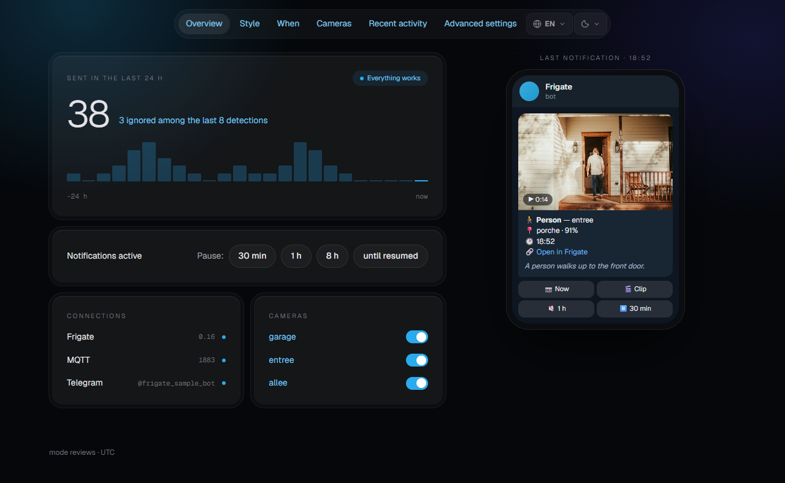
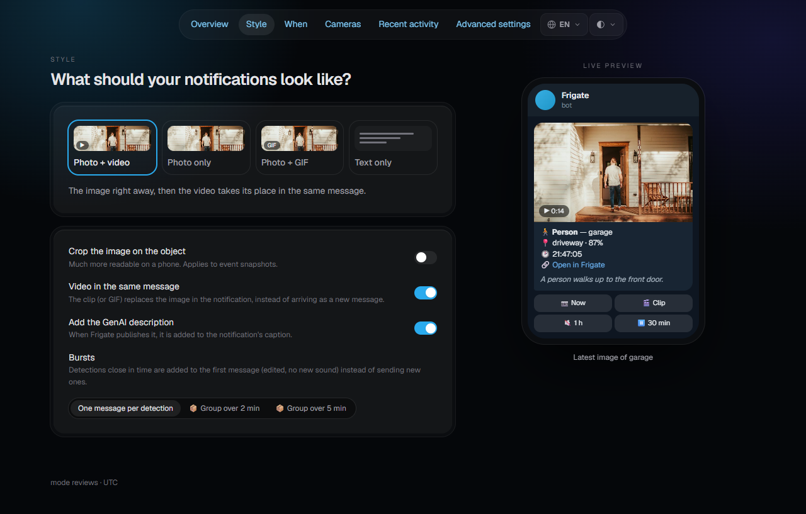
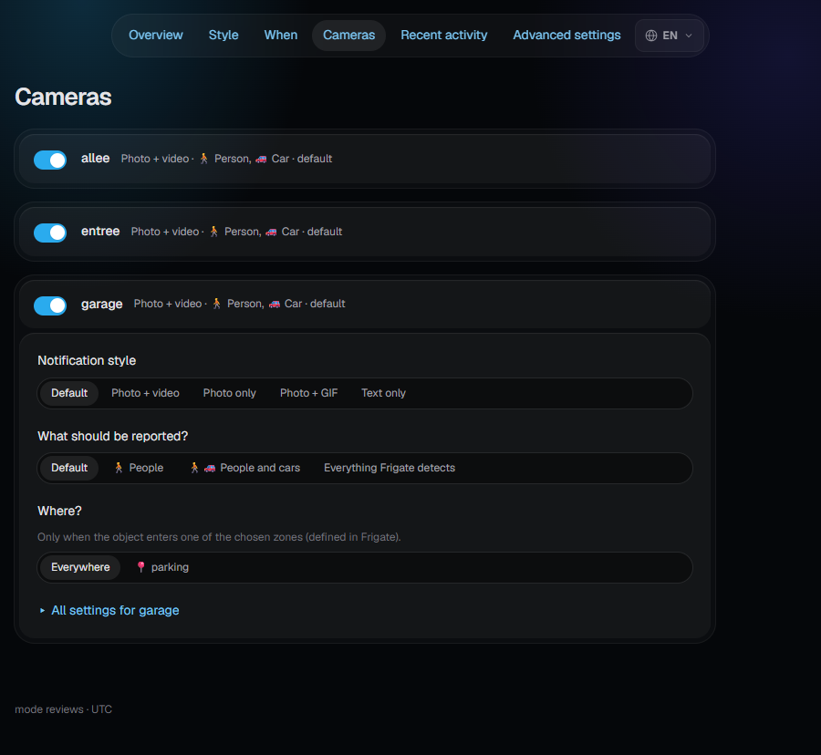
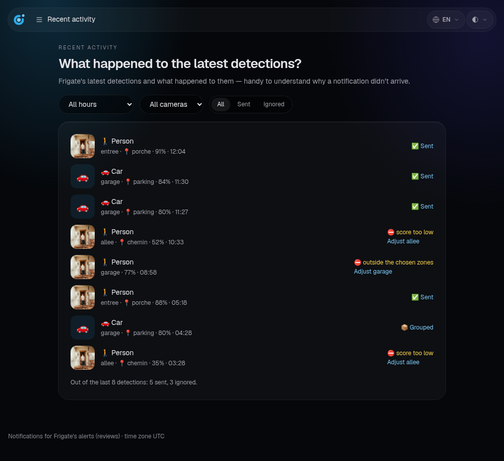
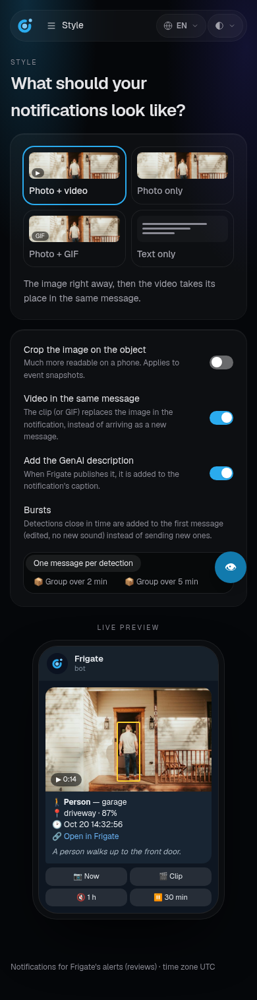
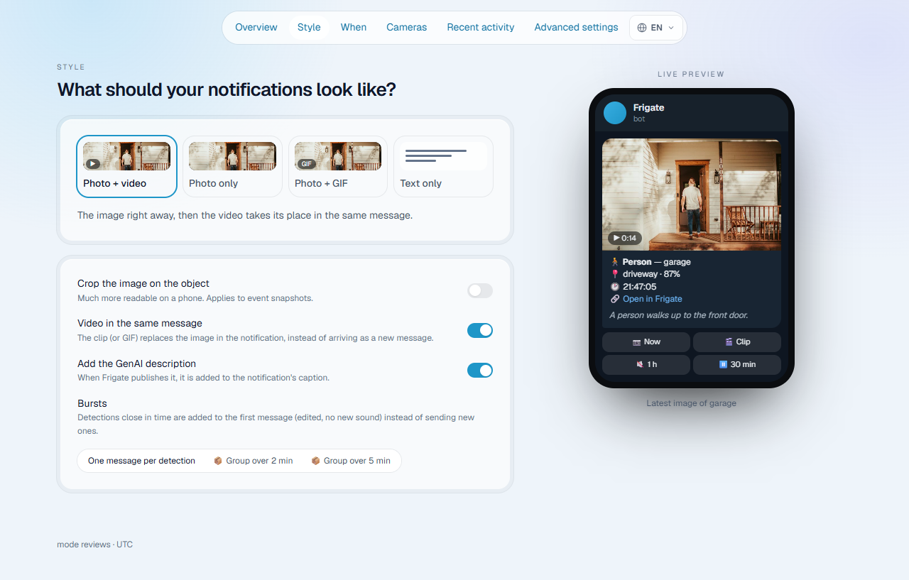

<p align="center">
  <picture>
    <source media="(prefers-color-scheme: dark)" srcset="docs/images/logo-dark.svg">
    
  </picture>
</p>

# frigate-telegram-enhanced

**English** · [Français](README.fr.md)

Telegram notifications for [Frigate NVR](https://frigate.video): a snapshot as soon as
something is detected, then the video clip in the same message — with fine-grained filters, a web
interface to set everything up in a few clicks, and control from Telegram itself.

<p align="center">
  
</p>

## Features

- **reviews** mode (grouped alerts, Frigate ≥ 0.14, the default) or **events** mode (one message per detected object)
- Instant snapshot, then the MP4 clip **in the same message** (it replaces the image, no second notification) or as a reply; optional GIF; above 50 MB, the beginning of the clip (its first 50 MB) with a link to the whole clip, or the whole clip re-encoded under 50 MB (*Compress clips over 50 MB*, off by default)
- **Sounds** (reviews mode): barking, smoke alarm, speech… heard by Frigate's audio detection, notified like objects — `🐕 Barking — garage`, see [Sounds](#sounds)
- Frigate's GenAI description added to the caption as soon as it is available
- Frigate's labels (custom classification such as your car's name, faces, license plates) added to the caption as soon as Frigate knows them — `🏷 clio 3`
- **Label filter**: don't get notified for your own car or cat, or only for unknown objects (waits up to 5 s for Frigate to recognize the object, only when this filter is on)
- Filters per camera, object, zone, minimum score and severity; cooldown; quiet hours and off hours
- **Web interface** to configure all of this without editing YAML, applied without a restart
- Several recipients, with per-camera routing
- Buttons on each notification: 📷 *now* (live image, to see if the person is still there), 🎬 *clip*, 🔇 *mute camera for 1 h*, ⏸ *pause 30 min*, and optionally 🏠 *Home Assistant* to open your dashboard (address set in the web interface, *Links*)
- `/menu`: a control panel with buttons to pause, resume and mute each camera
- Commands: `/pause`, `/resume`, `/status`, `/cameras`, `/snapshot`, `/last`
- **Burst grouping**: detections close in time are added to the first message instead of sending new ones
- **Cropped snapshots**: the image zoomed on the detected object, much more readable on a phone
- In **English**, **French**, **German**, **Spanish**, **Italian** or **Portuguese**: Telegram messages (chosen on the setup page) and the web interface (language switch) — other languages can be added with a single file, see [Translating](#translating)
- **Presence**: no notifications (or silent ones) while someone is home, from Home Assistant or any MQTT topic
- **Per-recipient settings**: e.g. you get everything, the family only people at night
- After an MQTT outage, detections missed during the last hour are caught up from Frigate
- **Outage alerts**: a Telegram message when Frigate stops responding or a camera sends no more images for 2 minutes, and another when it is back (*Outage alerts* in the advanced settings to turn them off)
- Persistent state, `/healthz`, Prometheus metrics, multi-arch distroless image (amd64 and arm64)

## A tour of the web interface

**Pick a notification style.** Four styles — *photo + video*, *photo only*,
*photo + GIF*, *text only* — each with a preview of the message as it will arrive in
Telegram. One click and every camera uses it. Below, a few switches: crop on the object,
video in the same message, Frigate's GenAI description, and bursts. The *When* screen
then asks, in a few multiple-choice questions, what to report, how often at most, and
what to do at night.

<p align="center">
  
</p>

**Fine-tune a camera.** Each camera has an on/off switch; open it to give it another
style, other objects or only some zones — otherwise it follows the general choices.
*Test this camera* sends a real sample notification.

<p align="center">
  
</p>

**Find out why a notification didn't arrive.** Recent activity lists the latest
detections and what happened to them: ✅ sent, or ⛔ ignored and why (outside the
selected zones, score too low, already reported a moment ago…), with a direct link to
the camera to adjust.

<p align="center">
  
</p>

**On a phone, in a light or dark theme.** The page adapts to the screen and follows the system theme (dark by default, light on the right); the theme menu in the header forces Light or Dark, or goes back to Auto, and is remembered (the setup and login pages follow it).

<p align="center">
  
  &nbsp;&nbsp;
  
</p>

## Requirements

1. **MQTT enabled in Frigate** (Frigate's `config.yml`):

   ```yaml
   mqtt:
     enabled: true
     host: mosquitto
     user: frigate
     password: ...
   ```

2. **A Telegram bot**: message [@BotFather](https://t.me/BotFather), send `/newbot`, and keep the token.

## Installation

1. Download the `docker-compose.yml` file — there is nothing to change in it:

   ```bash
   curl -O https://raw.githubusercontent.com/Limoniak/frigate-telegram-enhanced/main/docker-compose.yml
   docker compose up -d
   ```

2. Open `http://<server-ip>:8431/` (the IP address, not a host name, for this first
   visit). The setup page:
   - asks for the **bot token**, then to send `/start` to the bot from each Telegram
     account that should receive the notifications: they appear on the page, nothing
     to look up;
   - **looks for Frigate by itself** (on the machine the page was opened on, then the
     Docker host); if it is elsewhere, type its address, e.g. `http://192.168.1.10:5000`;
   - **fills in the MQTT broker** from Frigate's configuration and tries it: only its
     password is asked for, when it has one;
   - offers a password for the interface (optional) — language, time zone and the
     rest are under *More options*.

3. *Save and start*: the connections are checked, then the service starts and the
   page leads to the notification settings. Use *Send me a sample* to check that
   everything reaches Telegram.

The connection is saved in the volume (`/data/connection.yml`) and can be changed
later with *Connection*, the last item of the interface's menu.

> If Frigate and its MQTT broker run in Docker on the same machine, use the machine's
> IP address — `localhost` would point to the frigate-telegram-enhanced container itself.

The image is built by GitHub Actions and published to GitHub Container Registry:
`ghcr.io/limoniak/frigate-telegram-enhanced` (amd64 and arm64).

- `:latest` and `:main` — the latest commit of `main`, used by the provided
  `docker-compose.yml`
- `:2` — the latest 2.x release: fixes and new features, never a breaking change
  (that would be a 3.0); to only get releases, use it in `docker-compose.yml`
- `:X.Y` and `:X.Y.Z` — a precise release, published on every `v*` tag
- `:dev` — the `dev` branch, to try changes in progress
- `:sha-<short>` — a specific commit

What changes in each release is in the [changelog](CHANGELOG.md).

To update: `docker compose pull && docker compose up -d`.

## Configuration file

The setup page and the web interface cover a normal installation. A YAML file is
there for the rest — to prepare per-camera settings in advance, keep them under
version control, or reach the few settings the pages do not offer (presence, log
level, `/metrics` protection). The service reads no environment variables.

Copy [`config.example.yml`](config.example.yml) to `config/config.yml`, edit it, and
add this volume to the service:

```yaml
    volumes:
      - ./config:/config:ro
```

When `/config/config.yml` exists, it is the only source of configuration (the setup
page and its *Connection* menu are then not used). Its values are taken as they are:
`${VAR}` is not replaced. It holds the bot token and passwords, so keep it readable by
you alone. Key points:

- `notify` settings apply to every camera; an entry under `cameras` overrides them field by field.
- `zones`: only notify when the object has **entered** one of the listed zones.
- `quiet_hours`: notifications without sound; `off_hours`: no notifications at all.
- `reviews` mode: `severity: [alert]` follows Frigate's `review.alerts` configuration.

### Sounds

In `reviews` mode, the sounds of Frigate's [audio detection](https://docs.frigate.video/configuration/audio_detectors)
are notified like objects: the sound in the caption (`🐕 Barking — garage`), the camera's
image when it was heard, then the recording. They follow the same filters: a sound left
out of the notified objects is not notified, and the web interface offers the sounds
each camera listens to (`audio.listen`).

Frigate files a sound as a *detection*, not an *alert*, unless it is among the alert
labels. To be notified with the default settings, add the sounds to `review.alerts.labels`
in Frigate's configuration:

```yaml
review:
  alerts:
    labels: [person, car, bark, fire_alarm]
```

Or keep Frigate as it is and choose *Alerts and detections* in the web interface. The
`events` mode has no sounds: Frigate does not publish them on `frigate/events`.

## Web interface

`http://<server-ip>:8431/` serves a page to configure notifications, designed to be set
up in a few clicks. It follows the browser's language (English when it has no translation); the
language menu in the header changes it and is remembered. A pill menu at the top of the
page opens one screen per topic (on a phone, a ☰ button folds it into a list):

- **Overview**: notifications over 24 h, hour by hour; the connections to Frigate, MQTT
  and Telegram, with the cause in plain words and the setting to fix when one fails;
  pause for 30 min, 1 h, 8 h or until resumed; who is home; the cameras muted, to turn
  back on; the last notification as it arrived.
- **Style**: photo + video, photo only, photo + GIF or text only, each with a live preview
  of the message as it will arrive in Telegram, on a sample photo (zoomed on the person
  when the image is cropped on the object). Below: bursts (one message per detection,
  or detections within 2 or 5 minutes added to the first message, edited so no extra
  sound), framing (wide shot or zoom on the object), video (in the same message as the
  image, or as a reply) and Frigate's GenAI description in the caption. *Send me a
  sample* sends one to Telegram.
- **When**: what to report (the objects and sounds your cameras track in Frigate, each
  with its emoji; none ticked = everything), how often at most, what to do at night (same
  as daytime, silent, nothing — the night's hours are yours to set, 22:00–07:00 by
  default) and, with presence set up, when someone is home. **Sensitivity**: a slider for
  the minimum score; recent activity shows how many detections would have been ignored.
  With several chats, *Who receives the notifications?*: tick the chats, and open a name
  to give that person less — only some objects, or only at night, only during the day,
  silent at night.
- **Cameras**: one switch per camera; open it to give it another style, other objects or
  only some zones (*Where?*: everywhere, or zones defined in Frigate, in one click).
  *Test this camera* sends a real sample notification. Each camera has its own link
  (`#cameras/<name>`). Consistency warnings flag a camera set to report an object that
  Frigate does not track (missing from `objects.track`).
- **Recent activity** (when the history is available): the last 50 detections with their
  thumbnail and outcome — ✅ sent, or ⛔ ignored with the reason in plain words (outside the
  zones, score too low, already reported a moment ago…) and a link to adjust the camera.
  Filter by camera, outcome or hour; a line opens on the snapshot and an *Open in Frigate*
  link. The bars of the overview's 24 h chart lead to the notifications sent in that hour
  (the same hours can be picked in a menu). The last 50 detections are kept across restarts.
- **Advanced settings**: every global setting in detail, sorted by theme — recipients
  and filtering, media, pace, schedule and presence, links. The zones and objects offered
  come from Frigate's API. A camera's own settings are under *Cameras*, in *All settings
  for* that camera. **Links** holds the address used by "Open in Frigate" (default:
  Frigate's address) and the one of the 🏠 *Home Assistant* button (empty: no button);
  a *Test ↗* link opens each address once it is valid.

Every change is **saved by itself** and takes effect **immediately**, without a
restart; a status at the bottom of the screen confirms it. A value that could never
apply (a range that starts where it ends, a malformed duration or address) is flagged on
its field and not sent; a change the service refuses is reported and leaves it on the
previous settings.
On *When*, the finer choices — bursts, known labels and, outside the `reviews` mode,
sensitivity — are folded under *More choices*, and the defaults suit most installations.

Settings are saved in the data volume (`/data/notify.yml`), next to the state (pauses,
cooldowns) and the recent activity, so they survive restarts and updates. With a configuration file, they
**replace its `notify` and `cameras` sections** as long as they exist; the
*Back to the config.yml settings* button deletes them.
`config.yml` itself is never rewritten.

### Presence

In `config.yml`, set `presence.topics` to one or more MQTT topics that tell whether someone is home.
Someone is home as soon as one of them carries `home` (or `on`, `true`, `1`,
`present`). While someone is home, each camera follows its *When someone is home*
setting: nothing (default), silent, or as usual — handy to keep outdoor cameras on.

With Home Assistant, publish the `person` entities to MQTT, for instance with
[`mqtt_statestream`](https://www.home-assistant.io/integrations/mqtt_statestream/):

```yaml
# Home Assistant configuration.yaml
mqtt_statestream:
  base_topic: homeassistant
  include:
    domains: [person]
```

then, in `config.yml`:

```yaml
presence:
  topics: ["homeassistant/person/+/state"]
```

`/status` in Telegram and the web interface show who is home.

### Access and security

Without a password, the interface is open to anyone who can reach the port, and the
provided `docker-compose.yml` publishes `8431` on the whole network. **Set a
password** on the setup page (or `web.password` in a configuration file), or restrict the port to the machine
itself with `"127.0.0.1:8431:8431"`. (In a configuration file: `web.password`,
`web.allowed_hosts`, `web.protect_metrics`.) Until the setup is saved, the setup page
has no password: do it right after starting the container.

Without a password, the interface also only accepts requests addressed to an IP
address or to `localhost` (`http://192.168.1.10:8431/` works, `http://nas.lan:8431/` is
rejected with a 403). This blocks *DNS rebinding*, where a malicious site open in your
browser points its own domain at `127.0.0.1` to drive the interface behind your back.
To use a host name, add it to `web.allowed_hosts` in a configuration file, or set a password (which lifts this
check).

With a password, the interface opens on a login page; the session then lasts 30
days, survives restarts, and ends when the password changes (*Log out* at the bottom
of the page ends it sooner). After 5 wrong passwords within a minute, an address is
blocked for 5 minutes.

Another site cannot show the interface in a frame, which would let it make you click a
switch without knowing it. Home Assistant can, at the address of its 🏠 button
(*Advanced settings*, *Links*): a dashboard's *Webpage* card then shows the interface.
If you open Home Assistant at another address and the card stays blank, add that
address under *Sites that may show this page*, just below.

Authentication only covers the interface: `/healthz` always stays open for the
container probe, and so does `/metrics`, unless `protect_metrics: true`. Keep this in
mind if the port is exposed to the network: per-camera and per-object counters reveal
when there is activity at your place — `web.protect_metrics: true` protects them.
Prometheus then authenticates with `basic_auth` (any user name, the interface's password).

## Telegram commands

| Command | Effect |
|---|---|
| `/menu` | Control panel: pause / resume, and a button per camera to mute it for 1 h or turn it back on |
| `/pause [duration] [camera]` | Pause everything or one camera (1 h by default, `0` = until `/resume`). Durations: `30m`, `2h`, `1d` |
| `/resume [camera]` | Resume one camera, or everything without an argument |
| `/status` | MQTT connection, active pauses, notifications over 24 h |
| `/cameras` | Cameras and their state |
| `/snapshot [camera]` | Live image |
| `/last [camera]` | Latest event (snapshot and clip) |

Only the users listed in `telegram.admins` can use the commands and buttons. Without
admins, anyone in a recipient chat can: the person of a private chat, the members of a
group.

## Monitoring

- `GET /healthz`: 200 when MQTT is connected and Telegram is reachable (used by the Docker `HEALTHCHECK`)
- `GET /metrics`: Prometheus metrics prefixed with `ft_`
- `/healthz` is never protected; `/metrics` is protected by the password when `web.protect_metrics: true`

## Troubleshooting

- **The container stops right away**: `docker compose logs` says what is wrong
  in `config.yml`.
- **The setup page answers 403**: open it with the server's IP address
  (`http://192.168.1.10:8431/`), not its host name.
- **No notifications**: open *recent activity* in the web interface, which gives the
  reason for every ignored detection. Otherwise, set `log_level: debug` in `config.yml`, then check
  `ft_events_received_total` and `ft_events_filtered_total{reason=...}` on `/metrics`.
- **Missing clip**: increase `clip_delay` (Frigate hasn't finished writing the clip yet).
- **Interface returns 403 "host not allowed"**: see
  [Access and security](#access-and-security) — add the host name to
  `web.allowed_hosts` or set a password.
- **`permission denied` on `/data`**: only happens if you replaced the named volume with
  a folder (`./data:/data`); give it to the container's user with
  `sudo chown 65532:65532 data`.
- **Interface settings ignored at startup**: the log explains why `/data/notify.yml` was set aside (a chat removed from `telegram.chats`, for example). The service then falls back to `config.yml`.

## Development

Contributions are welcome: see [CONTRIBUTING.md](CONTRIBUTING.md) for the conventions and the
checks, and [SECURITY.md](SECURITY.md) to report a vulnerability.

```bash
go test ./...
go test -tags browser ./internal/web/   # web interface smoke test, needs Chrome
go build ./cmd/frigate-telegram-enhanced
```

The whole web interface (setup, login and the main interface) is built from `web/` (Svelte and
Tailwind) into `internal/web/dist/`, which is committed; see [CONTRIBUTING.md](CONTRIBUTING.md).

### Translating

Texts are written in English in the code. Each other language has a catalog,
`internal/i18n/locales/<code>.json`, that maps every English text to its translation —
for Telegram messages, error messages and the web interface alike:

```json
{
  "name": "Deutsch",
  "messages": {
    "Help": "Hilfe",
    "%s back on": "%s wieder an"
  }
}
```

To add a language, copy `fr.json` to `<code>.json` (`de.json`, `es.json`…), change
`name` and translate the values, keeping the `%s` and `%d` in the same order. A text
left out is shown in English. The new language is then offered by the setup page, accepted by `language` in
`config.yml`, and offered by the web interface's language switch. `go test ./internal/i18n/` checks the
catalogs: `%s`/`%d` kept, and every catalog in step with the code (every text
translated, none left over).

## License

[MIT](LICENSE). The Docker image also ships a static build of
[FFmpeg](https://ffmpeg.org/) (GPL, from [mwader/static-ffmpeg](https://github.com/wader/static-ffmpeg)),
used only to re-encode the clips over 50 MB.

The sample photo of the previews (`web/src/assets/sample.jpg`) is under the [Unsplash License](https://unsplash.com/license), see `web/src/assets/CREDITS.md`.
